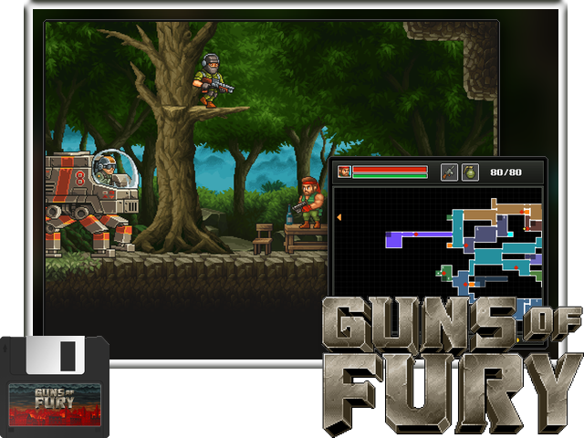

# Guns of Fury

## Installation
Buy the game on Steam and add the data to `gunsoffury/assets`

https://store.steampowered.com/app/3099000/Guns_of_Fury/

## Dual screen
On devices with two screens, the map, HUD and menus are on the second one. Drag or pinch the map to look around, and tap it to return to the player.

`Settings > Second Screen` turns this off. It's only listed when there's a second screen.

## Map hints
The map marks where to go next, and diamonds mark doorways you haven't been through. `Settings > Map Hints` turns them off.

## Default Gameplay Controls (Xbox Layout)
| Button            | Action                                |
|--                 |--                                     |
| START             | Menus                                 |
| SELECT            | Map                                   |
| D-PAD / JOYSTICK  | Move                                  |
| A                 | Jump                                  |
| B                 | Secondary Weapon                      |
| X                 | Primary Weapon                        |
| Y                 | Melee Weapon                          |
| L1                | Throw Weapon                          |
| R1                | Ability 1                             |
| L2                | Ability 2                             |
| R2                | Ability 3                             |

## Runtimes

This port requires the following:

- [gmtoolkit.aarch64](https://github.com/JeodC/gmtoolkit/releases/latest) placed in the `PortMaster/` folder.
- [gmloadernext.squashfs](https://github.com/JeodC/RHH-Ports/raw/main/runtimes/gmloadernext.squashfs) placed in the `PortMaster/libs/` folder.

[Pharos](https://github.com/JeodC/RHH-Ports/releases/download/ports-latest/pharos.zip) will fetch these automatically when installing the port. Otherwise download them manually and add them to the correct folders.

## Thanks
Gelato Games -- The amazing game  
JohnnyOnFlame -- GMLoader-Next  
PortMaster -- Testers & Devs  